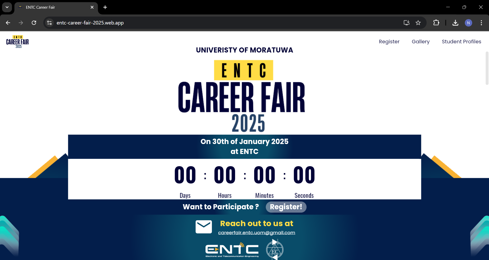

# Career fair web app

As one of the web designers of the Electronic Club, this was one of the major projects I have worked on so far–developing the web application for the official career fair of our department, ENTC. The web app serves as a comprehensive platform for students to showcase their profiles and for companies to register their organizations, explore student profiles, and access supporting resources.

**⭐ Highlights:**

- User-friendly interface for all users: students and organizations.
- Responsive design for optimal usability across devices.
- Real-time updates for schedule changes and announcements.

**⚒️ Technology Stack:**

- Frontend: Flutter (Dart)
- Backend: Firebase
- Hosting: Firebase
- Version Control: Git

👉 Career Fair 2025 Web App: [https://entc-career-fair-2025.web.app/](https://entc-career-fair-2025.web.app/)

