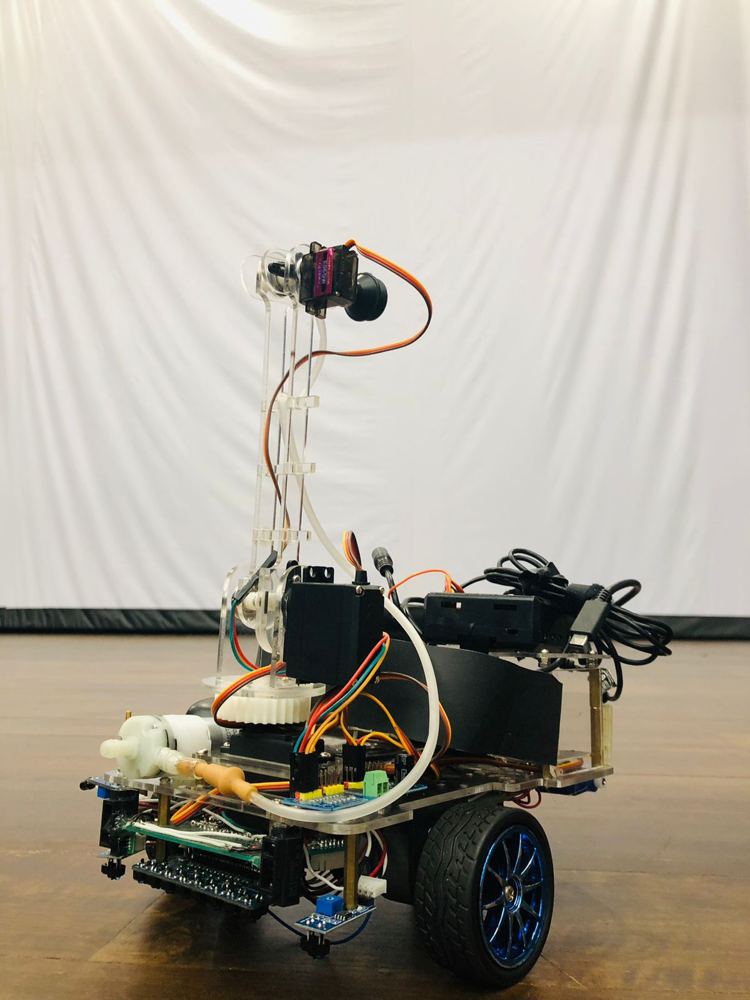
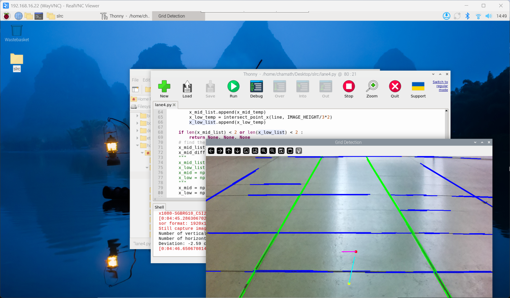
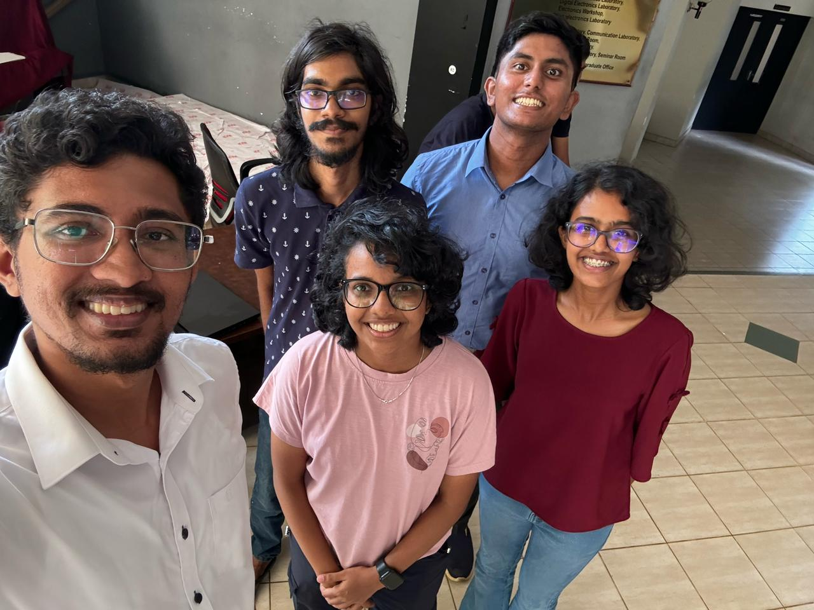

# Sri Lanka Robotics Challenge 2025

Sometimes, the most valuable trophies are the skills you gain and the problems you solve. That was my takeaway from participating in the Sri Lanka Robotics Challenge! 🤖

As part of our team, I mainly worked on:

💻 Developing the higher-level control logic for completing robotic tasks.

⚒️ Integrating ESP32-based navigation controller and Raspberry Pi-based computer vision and arm controller.

During the initial implementations, I worked on implementing:

👁️ Computer vision for lane detection (OpenCV + Python).

🔌 Serial communication between ESP32 and Raspberry Pi.

Cheers to my teammates chamath, oshani, kavishka, and yehen for the countless hours of debugging, hardware fixes, and optimization. This challenge taught us more about robotic systems and practical problem-solving than any textbook ever could! ⚙️

