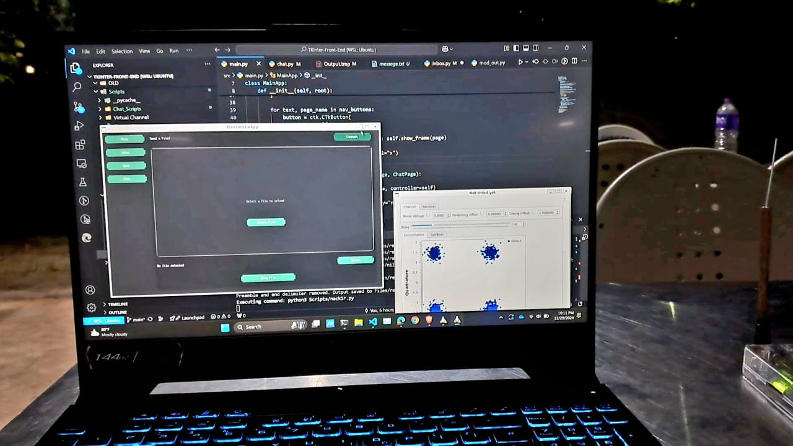

# TransmittixApp- point-to-point custom communication link

I had the opportunity to work on Transmittix App as part of a Semester 3 project — an innovative point-to-point communication link powered by GNU Radio, BladeRF, and Python.

Key Features of Transmittix App:

- 💡 A versatile user interface for sending and receiving files, images, audio, and video.
- 💬 A live chat app enabling real-time communication between two devices.
- 🌐 A custom communication link tested for reliability up to 13 meters.

⚒️ My contributions:

- designing the synchronization process to minimize errors,
- crafting the GUI frontend using Python-Tkinter, and
- developing the live chat feature.

This experience was an exciting journey in building robust and user-friendly communication systems.
