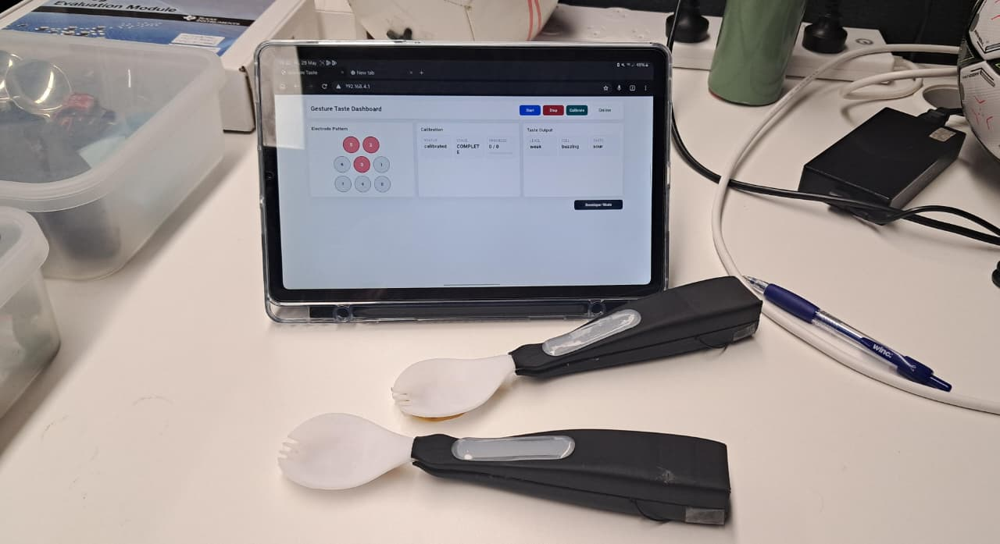
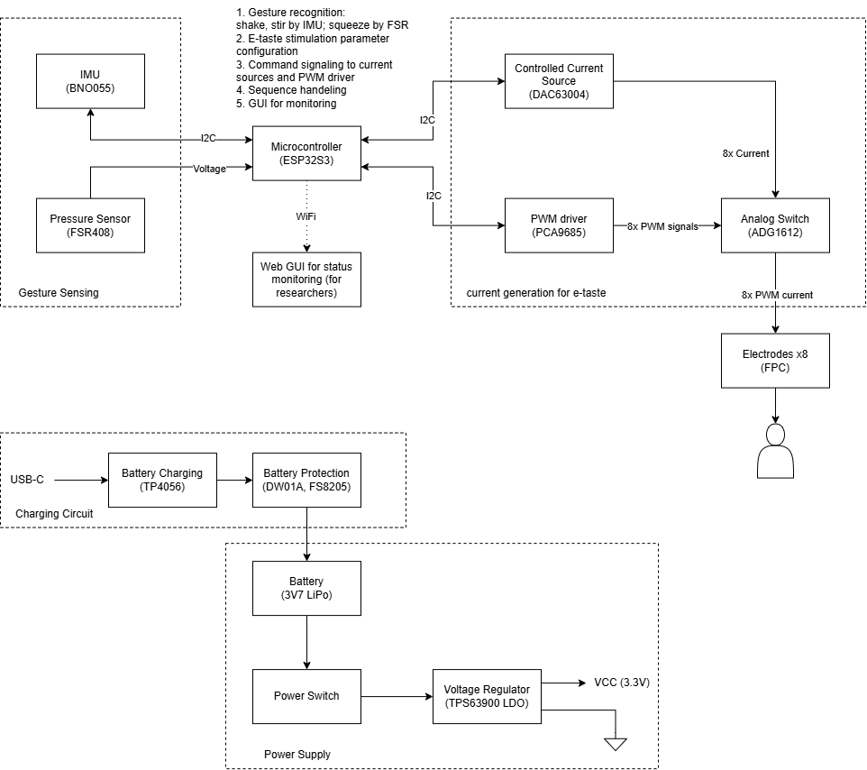
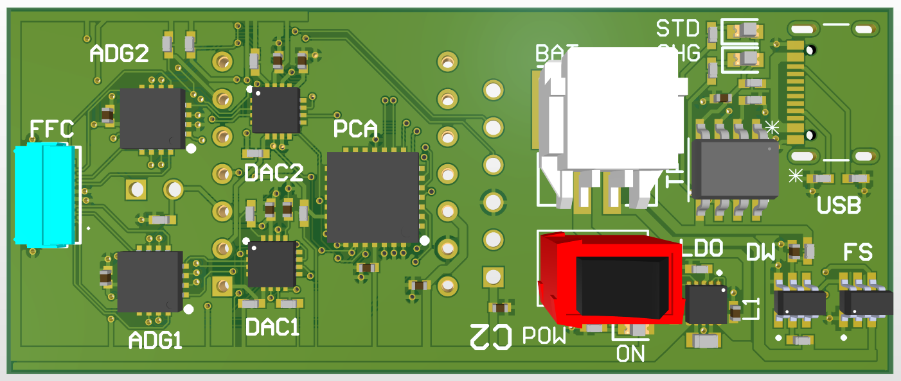
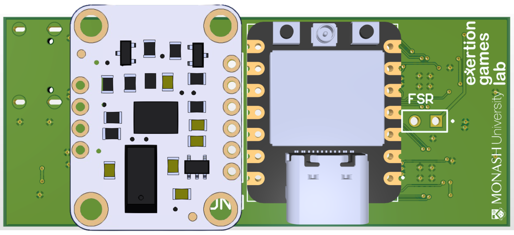
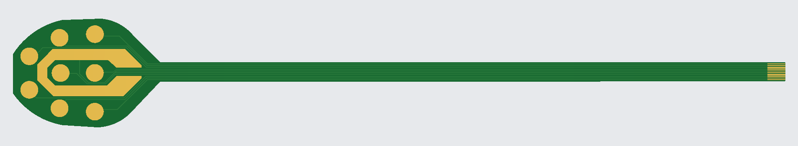
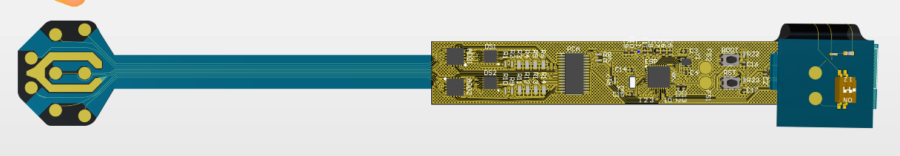
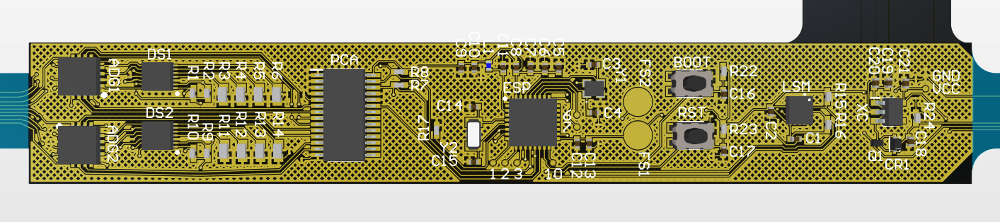
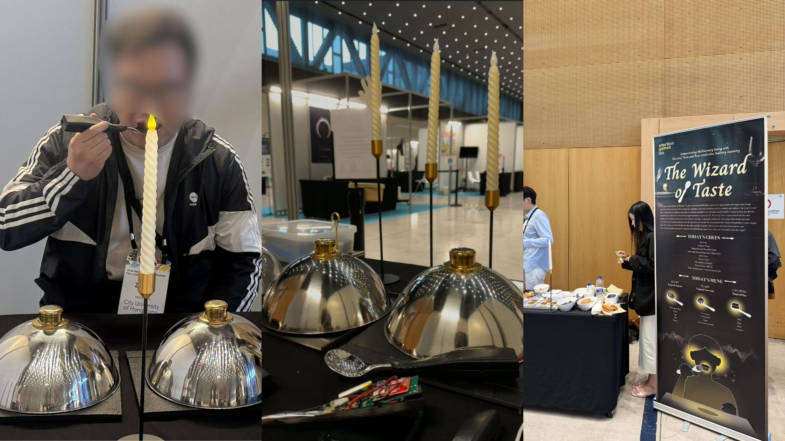
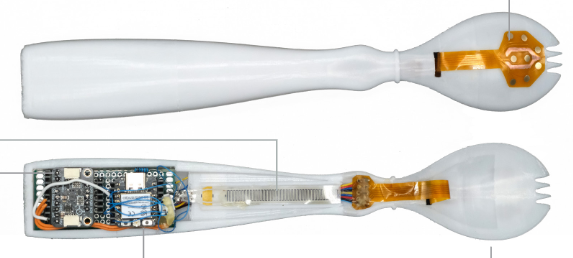

# Interactive Taste - Human-Computer Interaction

An interactive spoon for exploring electrical taste with hand gestures.

## System Overview
- **E-Taste Stimulation**: Uses electrical pulses to create taste and tactile sensations (sour, salty, smooth, sparkling)
- **Gesture Recognition**: Uses IMU and FSR sensor readings to classify hand movements for taste cues.
- **Digital Control**: ESP32-based firmware manages gesture recognition and current stimulation.
- **Web Interface**: Python-based web application for monitoring status and data collection for developers.

## Hardware Components

### Main Controller
- ESP32-S3 microcontroller with WiFi capabilities.
- Electrical stimulation by DAC and PWM control.
- IMU and FSR sensor interfacing capabilities.
- State machine based algorithm for gestue detection and stimulation andeling.

### Gesture Recognition
- **BNO-055** 9-DOF IMU for hand movement gesture recognition (stir, shake, tap).
- **FSR408** pressure sensor for squeeze gesture recognition.
- Gesture classification using statistical methods from sensor readings.

### E-Taste Delivery
- **DAC63004** for precise electrical current generation.
- **PCA9685** for controlled PWM signal generation.
- **ADG1612** for PWM switching for current control.
- Electrodes for taste stimulus delivery.

### Power Management
- Dedicated power supply circuit with **TP4056**.
- Charging and protection circuits with **DW01A** and **FS8206**.

## Software Components

Embedded Firmware: PlatformIO-based C++ project for ESP32.
- Sensor readings from IMU and FSR.
- Electrical stimulation control.
- Gesture detection algorithm.
- Network communication with web interface.

## PCB Designs

### Main PCB
- Integrates gesture detection IMU-FSR and e-taste components.
- Two-layer design with signaling, load currents, power, and area optimization.
- Fabrication and assembly files for manufacturing.

### Electrode FPC
- Flexible PCB design optimized for tongue contact.
- Seperate design allows modular development and various designs compatible with main PCB.
- Individual electrode control and for various configurations.

### Alternative Main PCB
- Area optimized design for flexible printed circuit fabrication. 
- Integrates IMU, FSR, and e-taste generation. 
- Can fit within a spoon handle occupying only a 15 mm x 100 mm area.

## Publications

### The Wizard of Taste: Demonstrating Multisensory Eating with Electrical Taste and Bone-conduction Auditory Seasoning 

Features multisensory eating experience, real-time taste modulation via electrodes, and auditory modulation via bone-conduction. 
The prototype demonstrates three multisensory eating scenes integrated with Spanish food: _happy scene_ paired with churros, uplifting audio and mild sour electrical taste, positive sensory associations; _scary scene_ paired with chocolate, unsettling audio tones and stronger salty stimulation, creates tension and intrigue; _calming scene_ paired with flan, soothing audio and gentle electrical tactile stimulus, relaxing sensory experience.

This was demonstrated at ACM CHI Conference on Human Factors in Computing Systems, Barcelona, Spain, April 13-17, 2026 in interactive demonstration paper track. [doi](https://dl.acm.org/doi/10.1145/3772363.3799379).

### EatDisco: Towards understanding the future of Interactive Taste

Features Interactive taste interface, gesture-based taste exploration, real-time taste modulation.
Submitted to DIS 2026 Pictorials. Not Accepted.

## Contributors 
Codebase and instrumentation by **Nilakna Warushavithana** during her internship at the Exertion Games Lab of Monash University. Developed for the PhD research of **Ziqi Fang**.

## Acknowledgement
Exertion Games Lab, Department of Human-Centred Computing, Monash University, Australia.